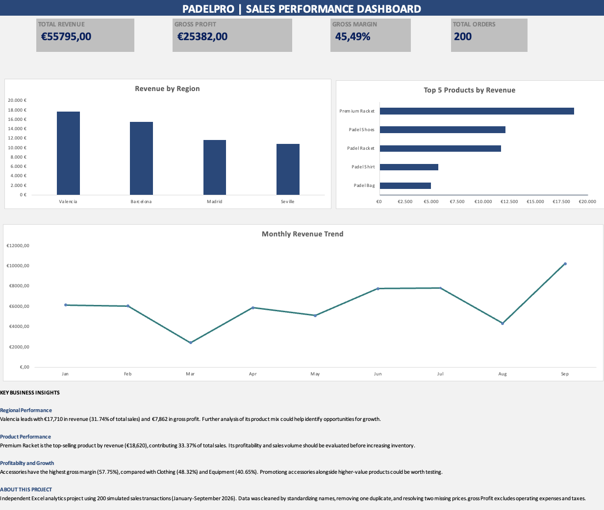

# PadelPro — Sales & Profitability Analysis

**Independent Excel Business Analytics Project | October 2026**

## Project Overview

PadelPro is a fictional padel equipment retailer operating across four Spanish cities. This project analyzes 200 simulated sales transactions to evaluate revenue, profitability, product performance, and regional trends.

The objective was to clean the dataset, develop a business performance dashboard, and identify actionable insights.

## Tools & Skills

- Microsoft Excel
- Pivot Tables and Pivot Charts
- SUMIFS, COUNTIFS, IF, XLOOKUP
- Data cleaning and validation
- Dashboard design and business analysis

## Dashboard

## Key Results

| Metric | Value |
|---|---:|
| Total Revenue | €55,795 |
| Gross Profit | €25,382 |
| Gross Margin | 45.49% |
| Valid Transactions | 200 |

## Business Insights

**1. Regional Performance:** Valencia generated the highest revenue (€17,710) and gross profit (€7,862).

**2. Product Performance:** Premium Racket generated the highest product revenue (€18,620), representing approximately 33.37% of total sales.

**3. Category Profitability:** Accessories achieved the highest gross margin (57.75%), compared with Clothing (48.32%) and Equipment (40.65%).

## Data Preparation

The dataset originally contained inconsistent product and region names, one duplicate transaction, and two missing unit prices.

I standardized text values, removed the duplicate, and resolved missing prices using matching product records.

I then calculated revenue, total cost, gross profit, and gross margin and developed Pivot Tables and charts to summarize the results.

## Limitations

This project uses simulated data and does not represent actual business results. Gross profit excludes operating expenses and taxes.

## Project File

Download the Excel workbook from this repository to explore the analysis and dashboard.
